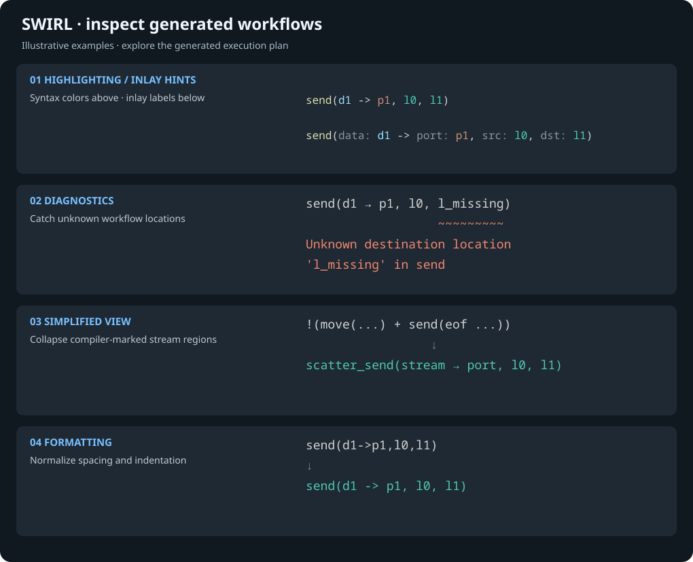

# SWIRL for VS Code

> [!WARNING]
> **Vibecoded repository.** This extension was developed with AI assistance. Treat it as experimental, review its output, and report unexpected behavior.

Inspect and understand compiler-generated `.swirl` workflows in VS Code. SWIRL is a compilation target rather than a language intended to be written by hand. This extension helps you read generated execution plans with syntax highlighting and inlay hints, diagnostics, a simplified view, and formatting.

SWIRL (Scientific Workflow Intermediate Representation Language) and its reference compiler come from the original project, **[alpha-unito/swirlc](https://github.com/alpha-unito/swirlc)**. See that repository for the language, compiler, and research references. This repository provides the VS Code extension.

## Quick start

1. Download `vscode-swirl-<version>.vsix` from the **Assets** section of a [GitHub Release](https://github.com/tomm2000/vscode-swirl-extension/releases). These packages are built by GitHub Actions. Alternatively, build a VSIX using the development instructions below.
2. In VS Code, run **Extensions: Install from VSIX…** and select the downloaded or locally built `.vsix` file.
3. Open a `.swirl` file generated by swirlc. For examples, try [workflow.swirl](examples/workflow.swirl) or [scatter-streamflow.swirl](examples/scatter-streamflow.swirl).
4. Run **Swirl: Open Simplified View** from the Command Palette to inspect stream operations, then use the Outline, location definitions, and hover cards to explore the execution plan.

## Features at a glance



*Illustration of extension behavior, not a screenshot.*

### Syntax highlighting and inlay hints

Syntax highlighting distinguishes predicates, data and port references, location sets, guards, comments, and compiler hint regions. This small execution plan shows a step at `l0` sending its result to `l1`:

```swirl
// A step on l0 sends its result to l1.
<l0, {(p_in, d_in)},
  exec(s_process, {(p_in, d_in)} -> {(p_out, d_out)}, {l0})
  . send(d_out -> p_out, l0, l1)
> |
<l1, {},
  recv(d_out -> p_out, l0, l1)
>
```

Optional parameter inlay hints explain argument roles while reading generated predicates. Labels are editor overlays, not SWIRL source. Hover over a label for its description.

Source:

```swirl
send(d_out -> p_out, l0, l1)
```

With hints (illustration, not source syntax):

```text
send(data: d_out -> port: p_out, src: l0, dst: l1)
```

For `exec`, hints identify `step:`, `in:`, `out:`, and `mapping:`. Optional location labels identify `loc:`, `data:`, and `trace:`.

### Diagnostics

Reports syntax errors, duplicate or unknown locations, conflicting communication locations, potentially unmatched send/receive pairs, and unbalanced or mismatched compiler hint regions. Communication checks flag possible problems; they do not prove that a workflow is deadlock-free.

```swirl
<l0, {},
  send(d1 -> p1, l0, l_missing)
>
```

```text
                          ^^^^^^^^^
Unknown destination location 'l_missing' in send
```

### Simplified view

Run **Swirl: Open Simplified View** from the Command Palette, editor title button, or editor context menu. The read-only view updates as you edit the original file. Use **Swirl: Open Original Source** to return.

Compiler-marked stream regions are collapsed into `scatter_send` and `gather_recv`. Compatible parallel scatter sends are merged into a destination set.

Original stream region:

```swirl
// @compiler begin scatter_stream stream_d_files l1 p_scatter
!(
  move((?element_d_files, ?key_0) -> p_scatter, l0, l1)
  +
  send(eof -> p_scatter, l0, l1)
)
// @compiler end scatter_stream stream_d_files l1 p_scatter
```

Simplified view:

```swirl
scatter_send(stream_d_files -> p_scatter, l0, l1)
```

These are display summaries for inspection; use the original source with the compiler.

### Formatting

Run **Format Document** or **Swirl: Format Swirl Document** to normalize indentation and spacing while preserving comments and compiler hint boundaries.

Before:

```swirl
<l0,{},exec(s1,{}->{(p1,d1)},{l0})>
```

After:

```swirl
<l0, {}, exec(s1, {} -> {(p1, d1)}, {l0})>
```

## Additional tools

### Navigation, folding, and hover

- **Go to Symbol in Editor** opens the location, step, communication, and compiler-region outline.
- **Go to Definition** jumps to location definitions; **Find All References** locates matching identifiers within the current document.
- Fold location blocks, replication blocks, multiline delimiters, and compiler regions.
- Hover over predicates for signatures and examples, locations for workflow summaries, steps for dataflow details, and compiler hints for structured region metadata.

For the two-location example above, the Outline includes:

```text
l0
  exec s_process
  send d_out -> p_out
l1
  recv d_out -> p_out
```

*Outline sketch; exact labels depend on the construct.* Hovering over `send` shows its signature and explains how data is sent from the source to the destination location.

Snippets are also available for small manual experiments with locations, predicates, replication, and choices.

## Settings

| Setting | Default | Effect |
| --- | --- | --- |
| `swirl.inlayHints.parameterNames.enabled` | `true` | Show predicate argument labels. |
| `swirl.inlayHints.execFlowStyle` | `"inOut"` | Use separate `in:` / `out:` labels, or `"flow"` for one `flow:` label. |
| `swirl.inlayHints.locationTags.enabled` | `false` | Label the components of location declarations. |

VS Code's `editor.inlayHints.enabled` setting also controls hint visibility. The extension defaults it to `"on"` for SWIRL files.

## Development

Use Node.js and pnpm (the project pins `pnpm@9.15.4`).

```bash
pnpm install
pnpm run compile
pnpm test
```

Open this folder in VS Code and press **F5** with **Launch Client** selected to start an Extension Development Host. Open a `.swirl` file there to try the extension. Use `pnpm run watch` for incremental compilation.

Build the installable extension:

```bash
pnpm run package
code --install-extension "vscode-swirl-$(node -p "require('./package.json').version").vsix"
```

For GitHub Releases, push a tag in the form `vMAJOR.MINOR.PATCH` (for example, `v0.2.0`). GitHub Actions derives the version from that tag and updates all three package manifests in its build checkout before packaging. The VSIX filename, embedded extension version, workflow artifact, and release name therefore use the same version. These build-time updates are not committed back to the repository.

Packaging compiles and bundles the client and server before creating `vscode-swirl-<version>.vsix`; adjust the installation filename when the version changes.

The extension uses a Language Server Protocol client/server architecture:

| Path | Purpose |
| --- | --- |
| `client/src/` | VS Code activation, commands, and simplified document provider. |
| `server/src/` | Lexer, parser, analysis, formatting, navigation, hover, and inlay hints. |
| `server/src/test/` | Automated language-server tests. |
| `syntaxes/` | TextMate highlighting grammar. |
| `snippets/` | SWIRL snippet templates. |
| `examples/` | Sample workflow files. |

## License

[MIT](LICENSE).
